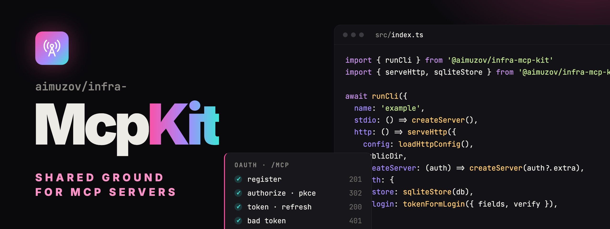

<p align="center">
	
	<a href="README.ru.md"></a>
</p>

<p align="center">
	
</p>

<p align="center">
	<a href="https://github.com/aimuzov/infra-mcp-kit/actions/workflows/check.yml"></a>
	<a href="https://github.com/aimuzov/infra-mcp-kit/releases"></a>
	<a href="package.json"></a>
	<a href="https://modelcontextprotocol.io"></a>
	<a href="LICENSE"></a>
</p>

<h3 align="center">One base for every aimuzov MCP server</h3>
<p align="center">stdio core, hosted OAuth connector, connector pages and test helpers</p>

Shared parts of the aimuzov MCP servers built from [infra-mcp-template](https://github.com/aimuzov/infra-mcp-template). A fix to OAuth, to the CLI or to the look of the connector pages lands here once instead of in every server.

## What's inside

- [**Core**](#core): `runCli`, `serveStdio`, tool results, env helpers, `dataDir`, a stderr logger, `readVersion` and [error reports to Sentry](#sentry).
- [**HTTP and OAuth**](#http-and-oauth): a stateless `/mcp` over Streamable HTTP, an OAuth server with single-use codes and rotating refresh tokens, Telegram and token-form sign-in, a JSON API for the account page.
- [**Pages**](#pages): the `mcpPages()` Astro integration with the landing, sign-in, error and 404 pages in the "Signal" style.
- [**Testing**](#testing): in-memory and HTTP clients and the whole OAuth flow for `node --test`.
- [**Actions**](#actions) `check` and `publish` for the server workflows.
- [**Moving to infra-site-kit 5**](#moving-to-infra-site-kit-5), [**migrating from 2.x**](#migrating-from-2x) and [from 1.x](#migrating-from-1x).

## Install

```bash
npm install -E github:aimuzov/infra-mcp-kit#v3.0.0
```

npm builds the package on install, `prepare` runs `tsc`. The `zod` 4 peer stays in the server, `@modelcontextprotocol/sdk` only in its devDependencies for `/testing`. Publishing to npm is ready but off until the repo variable `NPM_PUBLISH` is set.

## Core

```ts
import { readVersion, runCli } from '@aimuzov/infra-mcp-kit'

await runCli({
	name: 'example',
	version: readVersion(import.meta.url),
	usage: 'example: MCP server\n\nUsage: example [serve [--http] | --help | --version]',
	stdio: () => createServer(),
	http: () => import('./http.ts').then((m) => m.serve()),
	commands: { sync: (args) => sync(args) },
})
```

- `McpServer` has the API of the SDK on top of tmcp: `registerTool`, `registerPrompt`, `registerResource` with `ResourceTemplate`, `server.server.elicitInput()`. A thrown handler becomes a result with `isError`, `notifications/cancelled` aborts `extra.signal`, the protocol version of every `initialize` goes to the log. `.tmcp` is the server underneath.
- `runCli` handles `--help`, `--version`, `serve` (stdio, also with no arguments), `serve --http` and the service's own `commands`. An unknown command prints the usage and exits with 2, any error is one line `name: message` and exit 1; the stack is printed with `LOG_LEVEL=debug`.
- `serveStdio(server, name)` connects a server to stdio.
- `text`, `json` (plain objects also go to `structuredContent`) and `failure` build tool results. `tool(handler)` wraps a handler: a string becomes text, an object becomes JSON, a thrown error becomes `failure` and a log line.
- `str`, `required`, `int`, `bool` and `list` read env strictly: a typo in a number or a flag stops the start with the variable's name. `loadEnvFile()` reads `.env` without overriding what is set.
- `dataDir(name)` is `<NAME>_DATA_DIR`, then `$XDG_CONFIG_HOME/<name>`, then `~/.config/<name>`.
- `log` writes to stderr only, stdout belongs to the protocol. `LOG_LEVEL` is `error`, `warn`, `info` (default) or `debug`, `LOG_FILE` adds a file.
- `readVersion(import.meta.url)` finds the nearest `package.json`, so the MCP handshake never lags behind the release.

### Sentry

Set `SENTRY_DSN`, and `runCli` turns on error reports before it runs a command. The server writes no code for it, and without the variable the SDK is not even loaded. The variable has to be in the environment when `runCli` starts: if it lives in `.env`, call `loadEnvFile()` first.

- The release is `<name>@<version>` from `runCli`, so `name` should match the Sentry project. The environment is `production`, `SENTRY_ENVIRONMENT` changes it for a local check.
- Sent: uncaught exceptions and rejections (the process still exits with 1, once the event is out), errors of tool, prompt and resource handlers, including the ones the client gets back as `isError`, tagged `mcp.tool`, `mcp.prompt` or `mcp.resource`, failed HTTP, `/mcp` and OAuth requests and sign-ins tagged `http.path`, and an error that stops `runCli`.
- Kept on the server: tool arguments and results, headers, bodies, query strings, cookies and local variables. Only the error message and the stack leave, so user data has no place in error messages.
- Errors only, no traces. The client is `@sentry/core` instead of `@sentry/node`: 13 MB instead of 80, no OpenTelemetry and no breadcrumbs from the console or outgoing requests.
- A server that called `Sentry.init` itself before `runCli`, from any SDK version, gets no second client: the kit sends its errors through the server's client with the same tags and does not read `SENTRY_DSN`.
- A server without `runCli` calls `await initSentry({ name, version })` itself. `captureError(error, tags)` sends an error the server caught on its own, `withTags(tags, run)` tags every error inside `run`.

## HTTP and OAuth

```ts
import { loadHttpConfig, serveHttp, sqliteStore, tokenFormLogin } from '@aimuzov/infra-mcp-kit/http'

await serveHttp({
	config: loadHttpConfig(),
	service: { name: 'example' },
	publicDir: new URL('../build/public', import.meta.url).pathname,
	createServer: (auth) => createServer(auth?.extra),
	auth: {
		store: sqliteStore(`${dataDir('example')}/auth.db`),
		tokens: 'encrypt',
		login: tokenFormLogin({ fields: [{ name: 'token', label: 'API token' }], verify }),
	},
})
```

`createHttpApp` gives `{ handle, listener }` on `node:http` and web `Request`/`Response`, `serveHttp` also listens on `PORT`. Routes:

- `POST /mcp` builds a new server and transport for every request. With `auth` it wants a Bearer token, other methods get 405.
- `GET /health` answers `{ "ok": true }`.
- OAuth: metadata under `/.well-known/`, `/register`, `/authorize`, `/token`, `/revoke` and `/authorize/callback`.
- The pages from `publicDir`, `/x` serves `x.html`. A browser gets `404.html` for an unknown route and the `/error` page for a failure, `fetch` gets JSON.
- `routes(request, context)` adds the service's own API: a `Response`, or `undefined` to pass the request on.

`loadHttpConfig()` reads `PUBLIC_URL` (an origin, https outside loopback), `AUTH_SECRET` (at least 32 characters, `openssl rand -base64 48`), `PORT` (8080) and `ALLOWED_REDIRECT_URIS`. Claude's callbacks and loopback addresses are always allowed, the list adds to them.

OAuth rules:

- A client registers with at most 10 redirect URIs, each one checked.
- An authorization code lives 5 minutes, works once and only for its client.
- Access tokens live an hour. A refresh token lives 30 days and works once: the exchange gives a new one of the same family, and replaying a spent one revokes the family. A family lives at most 90 days from sign-in.
- `tokens: 'sign'` gives HS256 JWTs, `'encrypt'` gives JWEs. A sign-in that carries a third-party secret, like the token form, requires `encrypt`, so the secret is never readable from the token.
- `memoryStore()` keeps clients and codes in memory, `sqliteStore(path)` in `node:sqlite`, so a deploy does not log anyone out. `store.revokeSubject(sub)` revokes everything issued to a person.

Sign-in is a static page plus a `complete({ request, query, form })` hook that tells who came back:

- `telegramLogin({ botToken })` checks the Telegram widget signature, a sign-in older than 10 minutes or a replayed one is refused. `devUserId` enables `?dev=1` on loopback.
- `tokenFormLogin({ fields, verify })` takes the form by POST. `verify` returns `{ subject, claims }`, and the claims reach `createServer` in `auth.extra`. A `LoginError` brings the person back to the form with its message.

The sign-in context, the signed request, the client and the previous error, travels in the URL fragment, so it reaches neither the server logs nor the proxy.

For the account page: `sessions(tokens, publicUrl)` gives a signed httpOnly cookie, `requireSession(sessions, request)` gives the session or a 401 `Response`, `sameOrigin(publicUrl, request)` a 403 to a foreign `Origin`, `sendJson` and `apiError` build responses in one shape.

## Pages

The connector pages are static: Astro builds them into `build/public` with the server's `npm run build`, the server only serves files. Whatever depends on the person, the sign-in context or the account data, is drawn by Svelte islands in the browser.

They are built from [infra-site-kit](https://github.com/aimuzov/infra-site-kit), like the sites: the author credit, the theme switch with the peek circle, the base styles, the 404 page and the UI components. The "Signal" theme maps their tokens onto its palette, a service brings its accent color.

```js
import mcpPages from '@aimuzov/infra-mcp-kit/astro'
import svelte from '@astrojs/svelte'
import { defineConfig } from 'astro/config'

export default defineConfig({
	srcDir: './src/frontend',
	outDir: './build/public',
	integrations: [
		svelte(),
		mcpPages({
			service: {
				name: 'example',
				repo: 'https://github.com/aimuzov/example',
				tagline: 'What it does',
				tools: ['search'],
			},
			tokenForm: { title: 'Connect example', fields: [{ name: 'token', label: 'API token', type: 'password' }] },
		}),
	],
})
```

- `mcpPages` adds `/`, `/error`, `/404`, `/login` with `tokenForm` and `/login/telegram` with `telegram: { botName, grants }`. `override` leaves a page to the service. `service.accent` takes `{ light, dark }` colors.
- The pages ship with a strict CSP: scripts and styles by hash, everything else from `'self'`.
- A page of the service uses `@aimuzov/infra-mcp-kit/astro/layout.astro`. The islands are in `astro/components`: `AccountShell` loads `/account/state` and shows sign-in on 401, `Connect` shows the connector address.
- Dev dependencies of the server: `astro`, `@astrojs/svelte`, `svelte`, `@aimuzov/infra-site-kit` and `postcss-nested`, plus `svelte.config.js` with `vitePreprocess()` and `postcss.config.mjs` with `postcss-nested`. They never reach the runtime or `npx`. infra-site-kit goes in as `github:aimuzov/infra-site-kit#v5.8.1`, see [below](#moving-to-infra-site-kit-5).

[`e2e/connector`](e2e/connector) is a working example.

### Languages

With `locales: ['ru', 'en']` the kit builds every page twice: Russian without a prefix, English under `/en/`. The header gets the infra-site-kit language menu next to the theme button, the head gets `canonical` and `hreflang`, the texts of the kit come from its dictionaries and the shared parts from infra-site-kit.

English for the service's own config goes into `service.strings.en` by key: `service.tagline`, `service.lead`, `tool.<label>`, `tokenForm.title`, `tokenForm.lead`, `tokenForm.submit`, `field.<name>.label`, `field.<name>.placeholder`, `field.<name>.hint`, `telegram.grant.<i>`. A key with no translation shows the field as written, so a config stays as it is.

A page of the service covers both languages with `export const getStaticPaths = localePaths` in `pages/[...lang]/account.astro` and takes its own strings with `pt(locale, key)` from `@aimuzov/infra-mcp-kit/astro/lib/i18n.ts`.

On the first visit the server sends a person whose browser prefers English to `/en/...`. The menu remembers the choice in the `lang` cookie, and from then on the cookie decides. Login errors, the error page and the account API speak the language of the page they came from. `LoginError` takes `{ ru, en }`. OAuth errors stay in ASCII English: that's the protocol.

### Moving to infra-site-kit 5

The pages are checked on infra-site-kit 5.8.1, and that is the version to install. The kit's API stays the same, a server only moves its dev dependency:

```bash
npm install -E -D github:aimuzov/infra-site-kit#v5.8.1
```

- 5.0 drops the `approach` option of `themePeek`. The kit's theme button never passed it, so only a page of the server that calls `themePeek(node, { approach })` itself has to drop it.
- 5.1 turns the language switch into a menu: `details.lang` with a link per language instead of the `a.lang` link to the other one. A test of the server that clicked `a.lang` opens the menu first: `page.locator('details.lang summary').click()`, then `page.getByRole('link', { name: /English/ })`.
- A server that stays on 4.2 keeps working: the kit uses nothing that 4.2 lacks, its header just shows the old link.

## Testing

```ts
import {
	connectInMemory,
	expectTools,
	fakePages,
	oauthFlow,
	startHttp,
	submitForm,
} from '@aimuzov/infra-mcp-kit/testing'

const client = await connectInMemory(createServer())

await expectTools(client, ['search'])

const { base } = await startHttp(() => createHttpApp({ ...options, publicDir: fakePages() }))
const { tokens, exchangeAgain } = await oauthFlow({ base, login: submitForm({ token: 'good' }) })
```

- `connectInMemory` and `connectHttp` give an SDK client. `expectTools` compares the tool list, `textOf` joins a text result.
- `startHttp` listens on a random port of 127.0.0.1.
- `oauthFlow` runs register, authorize, sign-in, callback and the code exchange. `submitForm`, `telegramSigned` and `devLink` cover the ready sign-ins, `exchangeAgain` and `refresh` check single use.
- `fakePages()` gives a `publicDir` without building Astro.

## Actions

`.github/workflows/check.yml` of a server:

```yaml
jobs:
    check:
        runs-on: ubuntu-latest
        timeout-minutes: 15
        steps:
            - uses: aimuzov/infra-mcp-kit/check@v3
              with:
                  docker: deploy/Dockerfile
```

- `check`: `npm ci`, Prettier, oxlint, types, `astro check` and `svelte-check` when `astro.config.mjs` exists, `node --test`, the build and `smoke` (`node build/index.js --help`). Then it packs the server, installs the tarball without dev dependencies, as `npx` would, and runs its `--help`. With `docker` it also builds the image. Ubuntu packages go in `apt-packages`.
- `publish`: `npm publish --provenance` of a release tag, by `npm-token` or by trusted publishing.

Both are composite actions: the job stays in the server, so the required `check` status keeps its name.

## Releases

release-please through [aimuzov/.github](https://github.com/aimuzov/.github) keeps a release PR. Merging it cuts a release, the checks run again and the `v3` major tag moves to it, so `check@v3` follows patches.

Optional inputs of the action:

- `coverage-lines: 95` fails the check below 95% line coverage. The `test` script must start with `node`: the action puts the coverage flags right after it, because Node accepts them neither in `NODE_OPTIONS` nor after the test glob. Test files, `*.e2e.ts` and `testing/` helpers are left out of the count.
- `astro-tsconfig: tsconfig.astro.json` points `astro check` and `svelte-check` to their own config when the root one is for the server.
- `ui: true` runs `npm run test:ui` in Chromium after the build, with the browser cached by the Playwright version. The runner image already has the libraries Chromium needs, so apt runs only when the browser doesn't start without them, with a time limit and three attempts. `--with-deps` used to pull fonts from a slow mirror past the job timeout. A server that installs Playwright in its own steps after the action still runs `npx playwright install --with-deps chromium` and hits the same apt: replace those steps with `ui: true` and keep only `upload-artifact` for the screenshots.

The pages need infra-site-kit 4.2.0 or newer, the one with `i18n.js` and the language switch. `mcpPages()` checks the installed one and stops `astro check`, `astro build` and `astro dev` with the version to install, before Vite fails on `exports`. A version it can't parse, as in a fork or a local copy, gets only a warning. It is not a peer dependency: stdio servers without pages keep site-kit for the Prettier and oxlint configs, and an older one there must not break their `npm install`.

## Migrating from 2.x

3.0 runs on [tmcp](https://github.com/paoloricciuti/tmcp) instead of the official SDK and on `node:http` instead of express. A hosted server's runtime goes from 27 MB in 98 packages to 12 MB in 15, 8 MB of it zod. Issued tokens and `auth.db` stay as they are: nobody has to reconnect.

1. Dependencies: drop `@modelcontextprotocol/sdk` and `@types/express` from `dependencies`, add `zod` 4, move infra-site-kit to `#v5.8.1` as [above](#moving-to-infra-site-kit-5). The SDK stays in devDependencies for tests: `connectInMemory` and `connectHttp` still give its client.
2. Imports: `McpServer`, `ResourceTemplate`, `AuthInfo`, `CallToolResult` and the other result types come from `@aimuzov/infra-mcp-kit`. `registerTool`, `registerPrompt`, `registerResource`, `server.server.getClientCapabilities()` and `server.server.elicitInput()` keep the SDK signatures.
3. A thrown handler is a result with `isError`, as with `tool()`; the tool list keeps the input schema of the SDK.
4. `createHttpApp` returns `{ handle, listener, context }`: `handle(request)` takes a `Request` and gives a `Response`, `listener` goes to `node:http`. `startHttp` takes the app itself, `.app` is gone.
5. `routes(request, context)` returns a `Response` or `undefined` to pass the request on. `requireSession(sessions, request)` returns the session or a 401 `Response`, `sameOrigin(publicUrl, request)` a 403 or `undefined`. `sendJson(body, status, headers)` and `apiError(status, code, message)` return a `Response`. `sessions` gives `cookie(claims)` and `clearCookie()`, the values of `Set-Cookie`.
6. A custom `Login.complete` gets `{ request, method, query, form }` instead of an express request: the kit has already read the form.
7. `mountOAuth` is `oauthRouter` now, with `handle(request)` and `authenticate(request)`. Its errors are the kit's own `OAuthError` classes.
8. CI: `aimuzov/infra-mcp-kit/check@v3`.

Over HTTP a server still lives one request, as in 2.x: elicitation works over stdio only, progress comes in the SSE stream of the call.

## Migrating from 1.x

2.0 drops the HTML that the server rendered on request: every page is built by Astro.

1. Add the pages: the dev dependencies above, `astro.config.mjs` with `mcpPages()`, `svelte.config.js` and `postcss.config.mjs`. `npm run build` becomes `tsc` followed by `astro build`.
2. Pass `publicDir` to `createHttpApp` or `serveHttp`, with `auth` it is required. `landing` is gone, `service` is only `{ name }`: the repo, accent and texts moved to `mcpPages`.
3. `telegramLogin` drops `botName` and `grants`, `tokenFormLogin` drops `title`, `lead` and `submit`: they live in `mcpPages`. A custom `Login` replaces `render` with `page`, the path of its static page.
4. `ui`, `html`, `raw`, `escapeHtml`, `SafeHtml` and the `/_kit/*` assets are gone. An account page is a page of the service with an island in `AccountShell`, served by `requireSession` and `sendJson`.
5. Errors redirect to the static `/error` page, unknown routes get `404.html` or JSON.
6. Tests: `/authorize` answers 302 to the sign-in page, `oauthFlow` passes the `login` callback a `LoginStep` instead of HTML. `callbackFrom` and `hiddenField` are gone.
7. CI: `aimuzov/infra-mcp-kit/check@v2`.
