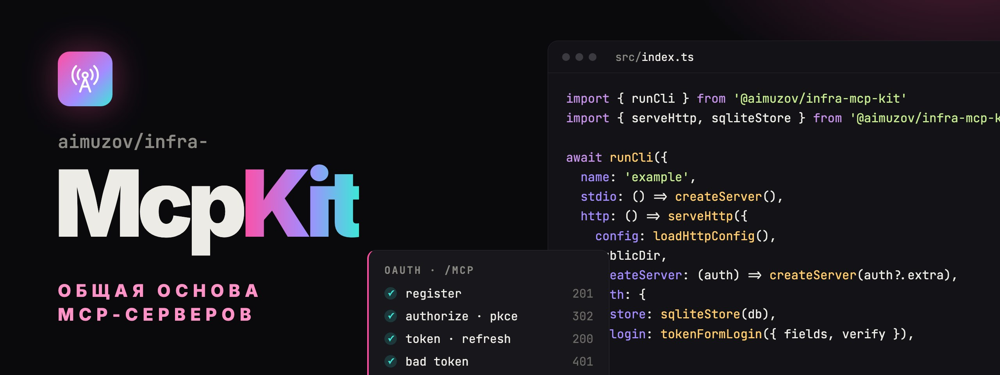

<p align="center">
	<a href="README.md"></a>
	
</p>

<p align="center">
	
</p>

<p align="center">
	<a href="https://github.com/aimuzov/infra-mcp-kit/actions/workflows/check.yml"></a>
	<a href="https://github.com/aimuzov/infra-mcp-kit/releases"></a>
	<a href="package.json"></a>
	<a href="https://modelcontextprotocol.io"></a>
	<a href="LICENSE"></a>
</p>

<h3 align="center">Одна основа для всех MCP-серверов aimuzov</h3>
<p align="center">Ядро на stdio, размещённый OAuth-коннектор, страницы коннектора и хелперы для тестов</p>

Общие части MCP-серверов aimuzov, собранных из [infra-mcp-template](https://github.com/aimuzov/infra-mcp-template). Правка OAuth, CLI или внешнего вида страниц коннектора попадает сюда один раз, а не в каждый сервер.

## Что внутри

- [**Ядро**](#ядро): `runCli`, `serveStdio`, результаты инструментов, хелперы окружения, `dataDir`, логгер в stderr, `readVersion` и [отчёты об ошибках в Sentry](#sentry).
- [**HTTP и OAuth**](#http-и-oauth): `/mcp` без состояния поверх Streamable HTTP, OAuth-сервер с одноразовыми кодами и ротацией refresh-токенов, вход через Telegram и форму токена, JSON-API для кабинета.
- [**Страницы**](#страницы): Astro-интеграция `mcpPages()` с лендингом, входом, страницами ошибки и 404 в стиле «Сигнал».
- [**Тесты**](#тесты): клиенты в памяти и по HTTP и весь OAuth-поток для `node --test`.
- [**Actions**](#actions) `check` и `publish` для workflow серверов.
- [**Переезд с 2.x**](#переезд-с-2x) и [с 1.x](#переезд-с-1x).

## Установка

```bash
npm install -E github:aimuzov/infra-mcp-kit#v3.0.0
```

npm собирает пакет при установке, `prepare` запускает `tsc`. Peer-зависимость `zod` 4 остаётся в сервере, `@modelcontextprotocol/sdk` — только в его devDependencies для `/testing`. Публикация в npm готова, но выключена, пока в репо не задана переменная `NPM_PUBLISH`.

## Ядро

```ts
import { readVersion, runCli } from '@aimuzov/infra-mcp-kit'

await runCli({
	name: 'example',
	version: readVersion(import.meta.url),
	usage: 'example: MCP server\n\nUsage: example [serve [--http] | --help | --version]',
	stdio: () => createServer(),
	http: () => import('./http.ts').then((m) => m.serve()),
	commands: { sync: (args) => sync(args) },
})
```

- `McpServer` — API SDK поверх tmcp: `registerTool`, `registerPrompt`, `registerResource` с `ResourceTemplate`, `server.server.elicitInput()`. Исключение в обработчике становится результатом с `isError`, `notifications/cancelled` обрывает `extra.signal`, версия протокола из каждого `initialize` пишется в лог. Под ним — сервер tmcp в `.tmcp`.
- `runCli` обрабатывает `--help`, `--version`, `serve` (stdio, и без аргументов тоже), `serve --http` и собственные `commands` сервиса. Неизвестная команда печатает usage и выходит с кодом 2, любая ошибка печатается одной строкой `name: message` с кодом 1, стек — при `LOG_LEVEL=debug`.
- `serveStdio(server, name)` подключает сервер к stdio.
- `text`, `json` (обычный объект попадает и в `structuredContent`) и `failure` собирают результат инструмента. `tool(handler)` оборачивает обработчик: строка становится текстом, объект — JSON, брошенная ошибка — `failure` и строкой в логе.
- `str`, `required`, `int`, `bool` и `list` читают окружение строго: опечатка в числе или флаге останавливает запуск с именем переменной. `loadEnvFile()` читает `.env`, не перезаписывая то, что уже задано.
- `dataDir(name)` — это `<NAME>_DATA_DIR`, затем `$XDG_CONFIG_HOME/<name>`, затем `~/.config/<name>`.
- `log` пишет только в stderr: stdout принадлежит протоколу. `LOG_LEVEL` — `error`, `warn`, `info` (по умолчанию) или `debug`, `LOG_FILE` добавляет файл.
- `readVersion(import.meta.url)` находит ближайший `package.json`, поэтому рукопожатие MCP не отстаёт от релиза.

### Sentry

Задайте `SENTRY_DSN`, и `runCli` включит отчёты об ошибках до запуска команды. Коду сервера ничего писать не нужно, а без переменной SDK даже не загружается. Переменная должна быть в окружении к старту `runCli`: если она в `.env`, сначала вызовите `loadEnvFile()`.

- Релиз — `<name>@<version>` из `runCli`, поэтому `name` должен совпадать с проектом в Sentry. Окружение — `production`, `SENTRY_ENVIRONMENT` меняет его для проверки на своей машине.
- Уходят: необработанные исключения и reject-ы (процесс всё так же выходит с кодом 1, когда событие отправлено), ошибки обработчиков инструментов, промптов и ресурсов, в том числе те, что клиент получает ответом с `isError`, с тегом `mcp.tool`, `mcp.prompt` или `mcp.resource`, упавшие запросы HTTP, `/mcp`, OAuth и входа с тегом `http.path`, и ошибка, на которой остановился `runCli`.
- Остаются на сервере: аргументы и ответы инструментов, заголовки, тела, query-параметры, cookie и локальные переменные. Наружу идут только текст ошибки и стек, поэтому данным людей в текстах ошибок не место.
- Только ошибки, без трейсов. Клиент — `@sentry/core`, а не `@sentry/node`: 13 МБ вместо 80, без OpenTelemetry и без хлебных крошек из консоли и исходящих запросов.
- Если сервер сам вызвал `Sentry.init` до `runCli`, из любой версии SDK, второй клиент не заводится: кит шлёт свои ошибки через клиент сервера с теми же тегами и `SENTRY_DSN` не читает.
- Сервер без `runCli` вызывает `await initSentry({ name, version })` сам. `captureError(error, tags)` отправляет ошибку, которую сервер поймал своими силами, `withTags(tags, run)` ставит теги на все ошибки внутри `run`.

## HTTP и OAuth

```ts
import { loadHttpConfig, serveHttp, sqliteStore, tokenFormLogin } from '@aimuzov/infra-mcp-kit/http'

await serveHttp({
	config: loadHttpConfig(),
	service: { name: 'example' },
	publicDir: new URL('../build/public', import.meta.url).pathname,
	createServer: (auth) => createServer(auth?.extra),
	auth: {
		store: sqliteStore(`${dataDir('example')}/auth.db`),
		tokens: 'encrypt',
		login: tokenFormLogin({ fields: [{ name: 'token', label: 'API-токен' }], verify }),
	},
})
```

`createHttpApp` отдаёт `{ handle, listener }` на `node:http` и веб-`Request`/`Response`, `serveHttp` ещё и слушает `PORT`. Маршруты:

- `POST /mcp` создаёт новый сервер и транспорт на каждый запрос. С `auth` требует Bearer-токен, другие методы получают 405.
- `GET /health` отвечает `{ "ok": true }`.
- OAuth: метаданные в `/.well-known/`, `/register`, `/authorize`, `/token`, `/revoke`, `/authorize/callback` и `/authorize/page`.
- Страницы из `publicDir`, `/x` отдаёт `x.html`. Браузер на неизвестный адрес получает `404.html`, при сбое — страницу `/error`, `fetch` получает JSON.
- `routes(request, context)` добавляет собственное API сервиса: `Response` или `undefined`, чтобы пропустить запрос дальше. Массив идёт по порядку, отвечает первый `Response`.

`loadHttpConfig()` читает `PUBLIC_URL` (origin, https везде, кроме loopback), `AUTH_SECRET` (от 32 символов, `openssl rand -base64 48`), `PORT` (8080) и `ALLOWED_REDIRECT_URIS`. Колбэки Claude и loopback-адреса разрешены всегда, список добавляется к ним.

Правила OAuth:

- Клиент регистрируется максимум с 10 redirect URI, каждый проверяется.
- Код авторизации живёт 5 минут, работает один раз и только для своего клиента.
- Access-токен живёт час. Refresh-токен живёт 30 дней и работает один раз: обмен выдаёт новый токен той же цепочки, а повтор уже потраченного отзывает всю цепочку. Цепочка живёт не дольше 90 дней от входа.
- `tokens: 'sign'` выдаёт JWT HS256, `'encrypt'` — JWE. Вход, который несёт чужой секрет, как форма токена, требует `encrypt`: из токена секрет не прочитать.
- `memoryStore()` держит клиентов и коды в памяти, `sqliteStore(path)` — в `node:sqlite`, поэтому деплой никого не разлогинивает. `store.revokeSubject(sub)` отзывает всё, что выдано человеку.

Вход — это статическая страница и хук `complete({ request, query, form })`, который говорит, кто вернулся:

- `telegramLogin({ botToken })` проверяет подпись виджета Telegram, вход старше 10 минут или повторный отклоняется. `devUserId` включает `?dev=1` на loopback.
- `tokenFormLogin({ fields, verify })` принимает форму POST-запросом. `verify` возвращает `{ subject, claims }`, и claims доходят до `createServer` в `auth.extra`. `LoginError` возвращает человека на форму со своим текстом.

Контекст входа — подписанный запрос, клиент и ошибка прошлой попытки — едет во фрагменте адреса и не попадает ни в логи сервера, ни в прокси. Фрагмент в ссылке подставит кто угодно, поэтому то, что решает, кому человек доверится, страница берёт с сервера: `Login.pageData` она получает по `GET /authorize/page`.

Для кабинета: `sessions(tokens, publicUrl)` даёт подписанную httpOnly-куку, `requireSession(sessions, request)` отдаёт сессию или `Response` 401, `sameOrigin(publicUrl, request)` — 403 на чужой `Origin`, `sendJson` и `apiError` собирают ответы в одном формате.

На https куки входа носят префикс `__Host-`, и своё имя сессии тоже. Такую куку браузер примет только от самого хоста, поэтому соседний поддомен не подложит свою сессию или метку входа через общий родительский домен. На http-localhost имена без префикса.

Сессию, выданную до префикса, `sessions` на https не читает: куку без префикса мог подложить кто угодно. Поэтому после обновления все, кто вошёл до него, входят заново.

### Telegram

```ts
const telegram = loadTelegramConfig(process.env, config.publicUrl)
const tokens = new Tokens({ secret: config.authSecret, issuer: config.publicUrl.href })
const account = sessions(tokens, config.publicUrl)

await serveHttp({
	...options,
	auth: { store, tokens, login: telegramLogin(telegram) },
	routes: [telegramAccount({ ...telegram, sessions: account }), cabinet(account)],
})
```

`loadTelegramConfig(env, publicUrl)` читает `TELEGRAM_BOT_TOKEN`, `TELEGRAM_BOT_NAME` и `TELEGRAM_DEV_USER_ID` (третий аргумент переименовывает последнюю). С dev-id бот не нужен, а сам dev-id работает только на loopback. `telegramAccount` проверяет и `devUserId`, переданный руками: при `PUBLIC_URL` не на loopback он не работает, а только оставляет предупреждение в логе.

Страницы собираются без этого окружения, поэтому имя бота сервер отдаёт им в рантайме: `telegramLogin({ botToken, botName })` отдаёт его `/login/telegram` через `GET /authorize/page`, `telegramAccount` — `/account/signin` через `GET /account/auth`. Из фрагмента бота страница не берёт: иначе ссылка показала бы виджет чужого бота.

`telegramAccount` пускает человека в кабинет через Telegram и держит его в куке сессии:

- `GET /account/auth` отдаёт странице входа имя бота и dev-id, а ещё одноразовую метку в httpOnly-куке `mcp_signin` на 10 минут.
- `GET /account/login` — сюда виджет возвращает человека. Кит проверяет подпись, её возраст, повтор и метку, ставит куку сессии и уводит в `/account` на языке страницы. Ссылка без подписи ведёт на `/account/signin`, поэтому «Войти» из `AccountShell` работает как есть.
- `POST /account/logout` стирает сессию, только со своего `Origin`.

Подпись годится один раз на оба входа: виджет подписывает только человека и время, поэтому потраченная в `telegramLogin` не откроет кабинет, и наоборот. Журнал потраченных подписей живёт в памяти процесса: после рестарта или в соседнем процессе подпись моложе 10 минут пройдёт ещё раз.

Метка закрывает login CSRF: без неё чужая подписанная ссылка тихо пустила бы человека в чужой кабинет, и он загрузил бы туда свои данные. `sessions` по умолчанию — `mcp_session` кита, на https — `__Host-mcp_session`; передай те же `sessions`, по которым твои маршруты зовут `requireSession`. `claims(user)` заменяет `{ name }` в сессии, `sub` — всегда Telegram id.

## Страницы

Страницы коннектора статические: Astro собирает их в `build/public` при `npm run build` сервера, сервер только отдаёт файлы. Всё, что зависит от человека, — контекст входа или данные кабинета — дорисовывают Svelte-острова в браузере.

Они собраны из [infra-site-kit](https://github.com/aimuzov/infra-site-kit), как и сайты: строка автора, переключатель темы с кругом подсмотра, базовые стили, страница 404 и UI-компоненты. Тема «Сигнал» переносит их токены на свою палитру, сервис приносит свой акцентный цвет.

```js
import mcpPages from '@aimuzov/infra-mcp-kit/astro'
import svelte from '@astrojs/svelte'
import { defineConfig } from 'astro/config'

export default defineConfig({
	srcDir: './src/frontend',
	outDir: './build/public',
	integrations: [
		svelte(),
		mcpPages({
			service: {
				name: 'example',
				repo: 'https://github.com/aimuzov/example',
				tagline: 'Что он делает',
				tools: ['search'],
			},
			tokenForm: {
				title: 'Подключение example',
				fields: [{ name: 'token', label: 'API-токен', type: 'password' }],
			},
		}),
	],
})
```

- `mcpPages` добавляет `/`, `/error`, `/404`, `/login` с `tokenForm`, `/login/telegram` с `telegram: { grants }` и вход в кабинет `/account/signin` с `telegram: { account: true }`. Имя бота приходит с сервера в рантайме. `telegram.botName` — запасное только для `/login/telegram`, если сервер его не прислал: `/account/signin` берёт бота лишь из `/account/auth`, поэтому `telegramAccount` без `botName` не соберётся, если это не dev-вход. `override` оставляет страницу сервису. `service.accent` принимает цвета `{ light, dark }`.
- У страниц строгий CSP: скрипты и стили по хешу, всё остальное с `'self'`.
- Своя страница сервиса строится на `@aimuzov/infra-mcp-kit/astro/layout.astro`. Острова лежат в `astro/components`: `AccountShell` загружает `/account/state` и на 401 показывает вход, `Connect` показывает адрес коннектора.
- Dev-зависимости сервера: `astro`, `@astrojs/svelte`, `svelte`, `@aimuzov/infra-site-kit` и `postcss-nested`, а также `svelte.config.js` с `vitePreprocess()` и `postcss.config.mjs` с `postcss-nested`. В рантайм и в `npx` они не попадают.

Рабочий пример — [`e2e/connector`](e2e/connector).

### Языки

С `locales: ['ru', 'en']` кит собирает каждую страницу дважды: русскую без префикса, английскую под `/en/`. В шапке рядом с кнопкой темы появляется переключатель языка, в `<head>` -- `canonical` и `hreflang`. Тексты кита берутся из его словарей, общие части -- из infra-site-kit.

Английский для полей конфига сервиса кладётся в `service.strings.en` по ключам: `service.tagline`, `service.lead`, `tool.<label>`, `tokenForm.title`, `tokenForm.lead`, `tokenForm.submit`, `field.<name>.label`, `field.<name>.placeholder`, `field.<name>.hint`, `telegram.grant.<i>`. Нет перевода -- поле показывается как в конфиге, так что старый конфиг остаётся как есть.

Своя страница сервиса покрывает оба языка через `export const getStaticPaths = localePaths` в `pages/[...lang]/account.astro`, а свои строки берёт через `pt(locale, key)` из `@aimuzov/infra-mcp-kit/astro/lib/i18n.ts`.

При первом заходе сервер уводит человека, чей браузер предпочитает английский, на `/en/...`. Переключатель запоминает выбор в cookie `lang`, и дальше решает она. Ошибки входа, страница ошибки и API кабинета говорят на языке страницы, с которой пришли. `LoginError` принимает `{ ru, en }`. Ошибки OAuth остаются ASCII на английском: это протокол.

## Тесты

```ts
import {
	connectInMemory,
	expectTools,
	fakePages,
	oauthFlow,
	startHttp,
	submitForm,
} from '@aimuzov/infra-mcp-kit/testing'

const client = await connectInMemory(createServer())

await expectTools(client, ['search'])

const { base } = await startHttp(() => createHttpApp({ ...options, publicDir: fakePages() }))
const { tokens, exchangeAgain } = await oauthFlow({ base, login: submitForm({ token: 'good' }) })
```

- `connectInMemory` и `connectHttp` дают клиента SDK. `expectTools` сверяет список инструментов, `textOf` склеивает текстовый ответ.
- `startHttp` слушает случайный порт на 127.0.0.1.
- `oauthFlow` проходит регистрацию, авторизацию, вход, колбэк и обмен кода. `submitForm`, `telegramSigned` и `devLink` покрывают готовые способы входа, `exchangeAgain` и `refresh` проверяют одноразовость.
- `accountLogin(base, { user, botToken })` входит в кабинет через `telegramAccount`, как это делают страница и виджет, и отдаёт заголовок `Cookie`. `'dev'` идёт по dev-ссылке.
- `freshTelegramLogin(user, botToken)` подписывает вход, как виджет, и у каждого вызова своя `auth_date`: те же поля в ту же секунду дают ту же подпись, и кит примет её за повтор. `auth_date` из `user` заменяет выбранную, и с ней два вызова снова могут дать одну подпись. Ей подписывают `telegramSigned` и `accountLogin`.
- `fakePages()` даёт `publicDir` без сборки Astro.

## Actions

`.github/workflows/check.yml` сервера:

```yaml
jobs:
    check:
        runs-on: ubuntu-latest
        timeout-minutes: 15
        steps:
            - uses: aimuzov/infra-mcp-kit/check@v3
              with:
                  docker: deploy/Dockerfile
```

- `check`: `npm ci`, Prettier, oxlint, типы, `astro check` и `svelte-check` при наличии `astro.config.mjs`, `node --test`, сборка и `smoke` (`node build/index.js --help`). Потом упаковывает сервер, ставит тарбол без dev-зависимостей, как это сделает `npx`, и запускает его `--help`. С `docker` ещё и собирает образ. Пакеты Ubuntu передаются в `apt-packages`.
- `publish`: `npm publish --provenance` релизного тега, по `npm-token` или через trusted publishing.

Это composite actions: job остаётся в сервере, поэтому обязательная проверка `check` не меняет имени.

## Релизы

release-please через [aimuzov/.github](https://github.com/aimuzov/.github) ведёт релизный PR. Его мёрж выпускает релиз, проверки проходят ещё раз, и мажорный тег `v3` переезжает на него, поэтому `check@v3` подхватывает патчи.

Необязательные входы action:

- `coverage-lines: 95` валит проверку при покрытии строк ниже 95%. Скрипт `test` должен начинаться с `node`: флаги покрытия action ставит сразу за ним, потому что ни в `NODE_OPTIONS`, ни после глоба тестов Node их не принимает. Тесты, `*.e2e.ts` и хелперы из `testing/` в счёт не идут.
- `astro-tsconfig: tsconfig.astro.json` -- свой конфиг для `astro check` и `svelte-check`, когда корневой отдан серверу.
- `ui: true` после сборки гоняет `npm run test:ui` в Chromium, браузер кэшируется по версии Playwright.

Страницам нужен infra-site-kit 4.1.1 или новее: CSP кита больше не пускает атрибут `style`, а старые `Skeleton` и `InfoTip` его пишут.

## Переезд с 2.x

3.0 работает на [tmcp](https://github.com/paoloricciuti/tmcp) вместо официального SDK и на `node:http` вместо express. Рантайм размещённого сервера худеет с 27 МБ в 98 пакетах до 12 МБ в 15, из них 8 МБ — zod. Выданные токены и `auth.db` остаются как есть: переподключаться никому не придётся.

1. Зависимости: убери `@modelcontextprotocol/sdk` и `@types/express` из `dependencies`, добавь `zod` 4. SDK остаётся в devDependencies для тестов: `connectInMemory` и `connectHttp` по-прежнему дают его клиента.
2. Импорты: `McpServer`, `ResourceTemplate`, `AuthInfo`, `CallToolResult` и другие типы результатов берутся из `@aimuzov/infra-mcp-kit`. У `registerTool`, `registerPrompt`, `registerResource`, `server.server.getClientCapabilities()` и `server.server.elicitInput()` сигнатуры SDK.
3. Исключение в обработчике — результат с `isError`, как у `tool()`; в списке инструментов схема входа та же, что у SDK.
4. `createHttpApp` отдаёт `{ handle, listener, context }`: `handle(request)` принимает `Request` и отдаёт `Response`, `listener` идёт в `node:http`. `startHttp` принимает само приложение, `.app` больше нет.
5. `routes(request, context)` отдаёт `Response` или `undefined`, чтобы пропустить запрос дальше. `requireSession(sessions, request)` отдаёт сессию или `Response` 401, `sameOrigin(publicUrl, request)` — 403 или `undefined`. `sendJson(body, status, headers)` и `apiError(status, code, message)` отдают `Response`. У `sessions` теперь `cookie(claims)` и `clearCookie()` — значения `Set-Cookie`.
6. Свой `Login.complete` получает `{ request, method, query, form }` вместо запроса express: форму кит уже прочитал.
7. `mountOAuth` теперь `oauthRouter` с `handle(request)` и `authenticate(request)`. Ошибки у него свои, классы `OAuthError` кита.
8. CI: `aimuzov/infra-mcp-kit/check@v3`.

По HTTP сервер по-прежнему живёт один запрос, как в 2.x: elicitation работает только по stdio, прогресс приходит в потоке SSE самого вызова.

## Переезд с 1.x

2.0 отказывается от HTML, который сервер рисовал на запрос: все страницы собирает Astro.

1. Добавь страницы: dev-зависимости выше, `astro.config.mjs` с `mcpPages()`, `svelte.config.js` и `postcss.config.mjs`. `npm run build` становится `tsc` и затем `astro build`.
2. Передай `publicDir` в `createHttpApp` или `serveHttp`, с `auth` он обязателен. `landing` убран, `service` — только `{ name }`: репозиторий, акцент и тексты переехали в `mcpPages`.
3. У `telegramLogin` больше нет `botName` и `grants`, у `tokenFormLogin` — `title`, `lead` и `submit`: они живут в `mcpPages`. Свой `Login` заменяет `render` на `page`, путь к своей статической странице.
4. Убраны `ui`, `html`, `raw`, `escapeHtml`, `SafeHtml` и ассеты `/_kit/*`. Кабинет — это страница сервиса с островом в `AccountShell`, который обслуживают `requireSession` и `sendJson`.
5. Ошибки ведут редиректом на статическую `/error`, неизвестные адреса получают `404.html` или JSON.
6. Тесты: `/authorize` отвечает 302 на страницу входа, `oauthFlow` передаёт в `login` разобранный `LoginStep` вместо HTML. `callbackFrom` и `hiddenField` убраны.
7. CI: `aimuzov/infra-mcp-kit/check@v2`.
